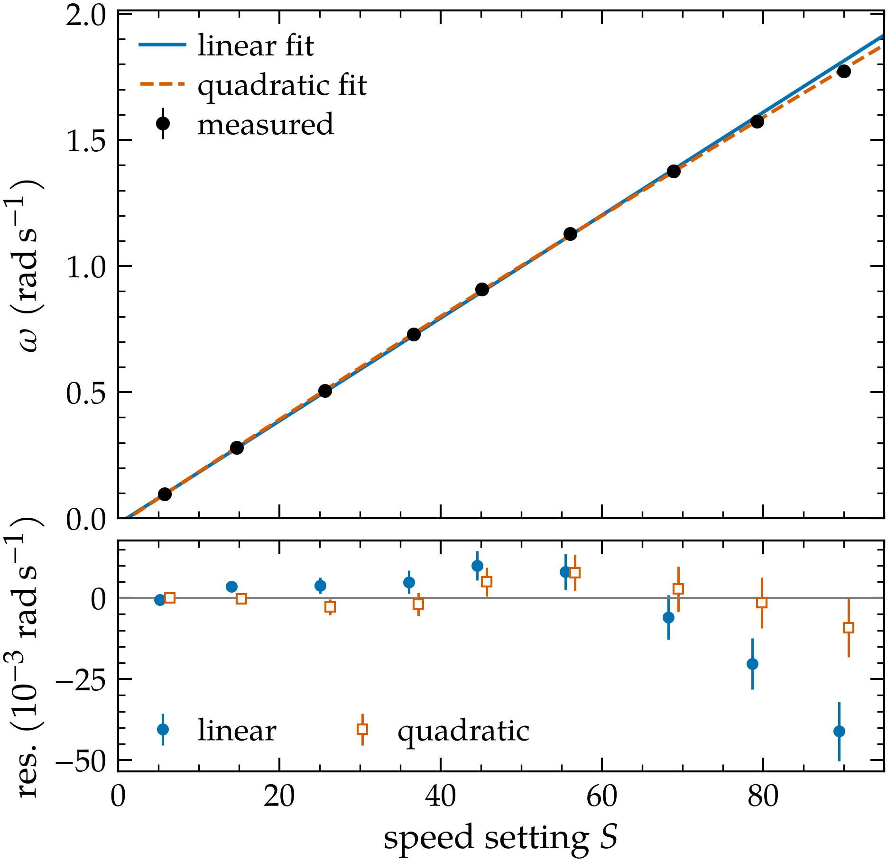
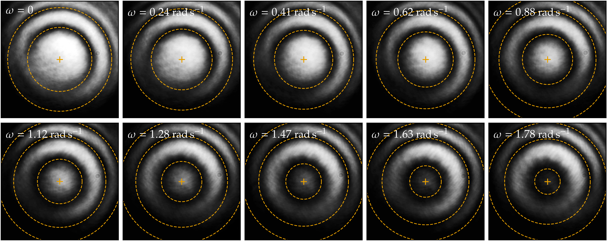
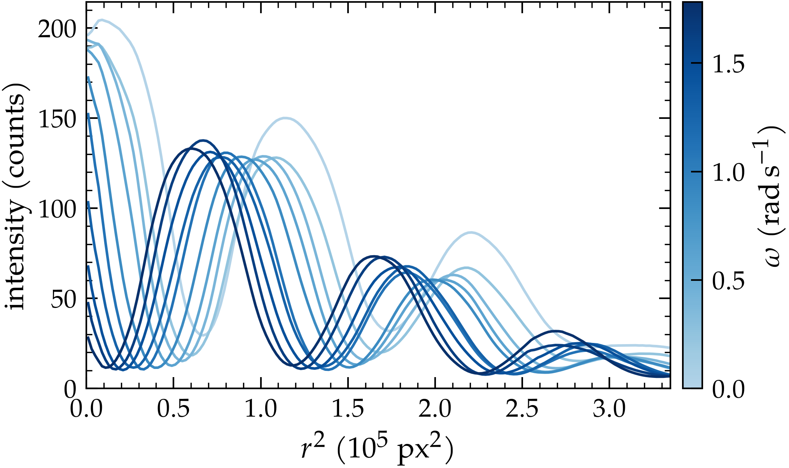
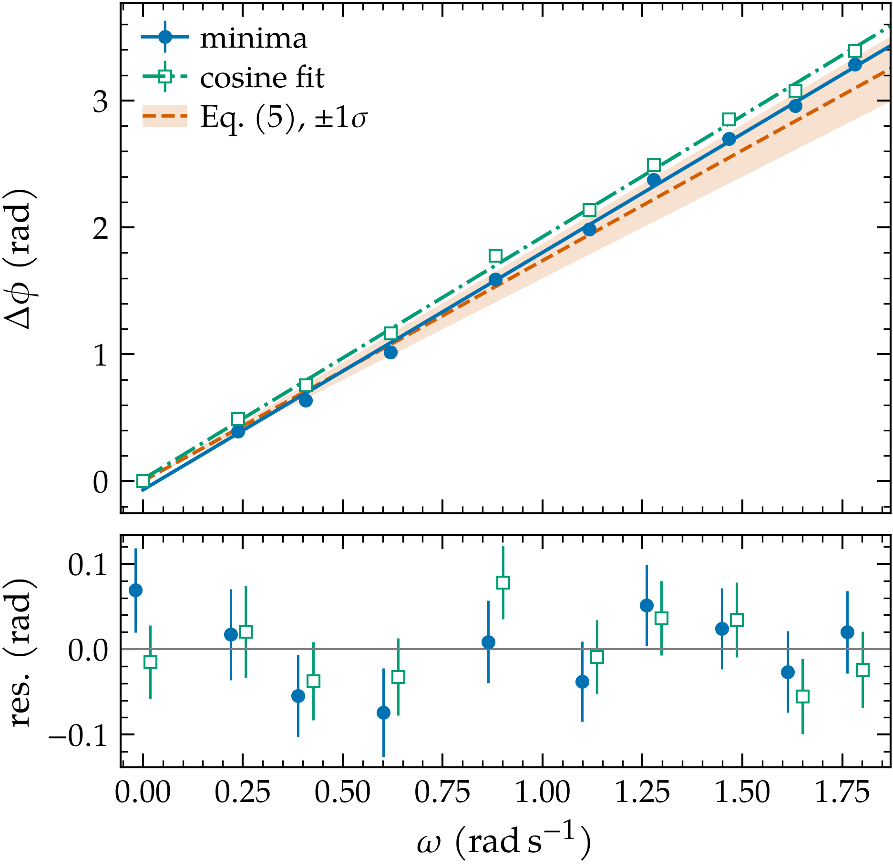
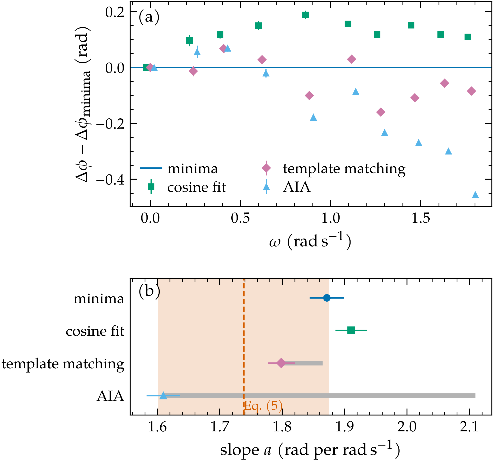
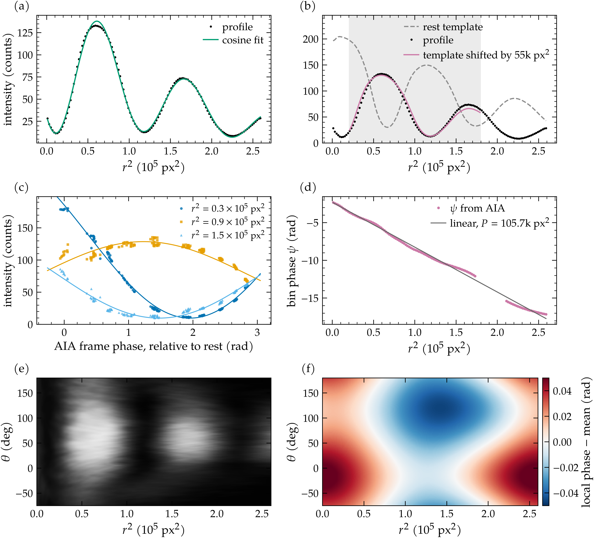

# Sagnac effect — results and methods (11 Oct 2026 data)

Uncertainties: 1 significant figure, kind in brackets. Comparisons use unrounded values. Full tables: `RESULTS.md`, `calibration.txt`, `sagnac.txt`.

## Setup

| N (turns) | R | λ | Fibre |
|---|---|---|---|
| 13 ± 1 (given) | 57.0 ± 0.5 cm (given) | 640 nm (no uncertainty given; excluded) | SMF-28e+ |

- Loop centred on the rotation axis.
- Calibration: stopwatch splits, 5–8 turns at each of 9 settings, S = 5.78–90.
- Fringes: 161 photos, 10–22 per setting, S = 0 and 9 speeds (12.59–90), taken in increasing order, 16:21–16:33.
- Manual tasks done: 1, 2, 3, 5. Task 4 (off-centre circle) not done.

Theory, Eq. (5) with A = πR²:

    Δφ = 8πNAω/(λc)   →   a_th = dΔφ/dω = 8π²NR²/(λc) = 1.7 ± 0.1 rad/(rad/s)   (N: 0.13, R: 0.03)

## Task 1 — rotation calibration

Method:
- T = (t_n − t_0)/n from splits; u(T) = SD/√(n(n+1)) (shared endpoints); ω = 2π/T. Stopwatch: 0.04–0.18 % of ω.
- Split-model check: lap lag-1 correlation −0.34; model predicts −0.43 ± 0.09 (simulated).
- Speed reproducibility ε = 0.48 % of ω, added in quadrature, set by χ² = dof for the quadratic.

| Model | Errors | χ² | dof | p |
|---|---|---|---|---|
| Linear (manual) | stopwatch | 807 | 7 | 6 × 10⁻¹⁷⁰ |
| Linear (manual) | + ε | 47.2 | 7 | 5 × 10⁻⁸ |
| Quadratic | stopwatch | 154.9 | 6 | 7 × 10⁻³¹ |
| **Quadratic (used)** | + ε | 6.0 | 6 | 0.42 (χ² = dof by construction) |
| Cubic (check) | + ε | 2.6 | 5 | 0.75 |

- Linear (+ ε): k = dω/dS = 0.02039 ± 0.00004 rad/s per unit S (fit); ω₀ = −0.0212 ± 0.0006 rad/s (fit). Rejected.
- Linear-model error: up to 0.041 rad/s (2.3 % of ω) at S = 90.
- ω per photographed setting: Task 3 table.

## Task 2 — fringe patterns

- Rings contract with ω; centre goes from bright (rest) to nearly dark: 0.52 ± 0.01 fringe (fit) at ω = 1.78 ± 0.01 rad/s.
- Fringes equally spaced in r²: P = 107.4k px² (range 105.8–109.4k px² between settings).
- Model: phase = 2πr²/P + φ_c (two Gaussian beams with different wavefront curvature). Sagnac shifts φ_c only.

## Task 3 — phase shift against ω

Method (fringe minima, main result):
1. Dark-ring minima along rays, sector −75° to 180°.
2. Concentric-circle fit → common centre, ring radii R_m.
3. R_m² against ring order m → P (slope), φ_c (intercept).
4. Δφ = φ_c − φ_c(rest). (Eq. 7 in r²; no pixel calibration needed.)
5. Per setting: mean of frames, SEM = SD/√n.
6. Weighted line Δφ = aω + b, per-setting error √(SEM² + (aεω)² + σ_x²).
   - Without σ_x: χ² = 62, dof = 8, p = 2 × 10⁻¹⁰.
   - σ_x = 0.045 rad per setting, set by χ² = dof.

| S | Frames | ω (rad/s) | Δφ (rad) |
|---|---|---|---|
| 0 | 10 | 0 | 0.00 ± 0.05 |
| 12.59 | 15 | 0.238 ± 0.001 | 0.39 ± 0.05 |
| 20.74 | 15 | 0.407 ± 0.002 | 0.64 ± 0.05 |
| 31.11 | 19 | 0.620 ± 0.003 | 1.02 ± 0.05 |
| 44.07 | 22 | 0.883 ± 0.005 | 1.59 ± 0.05 |
| 55.83 | 18 | 1.117 ± 0.006 | 1.98 ± 0.05 |
| 64.00 | 16 | 1.279 ± 0.007 | 2.38 ± 0.05 |
| 73.65 | 16 | 1.467 ± 0.008 | 2.70 ± 0.05 |
| 82.18 | 15 | 1.632 ± 0.009 | 2.96 ± 0.05 |
| 90.00 | 15 | 1.78 ± 0.01 | 3.29 ± 0.05 |

ω: calibration curve + reproducibility. Δφ: per-setting fit error.

| Result | Value | Uncertainty kind |
|---|---|---|
| a | 1.87 ± 0.03 rad/(rad/s) | fit 0.027, calibration curve 0.006 |
| a, with method systematic | 1.87 ± 0.06 rad/(rad/s) | + method 0.056 |
| a_th | 1.7 ± 0.1 rad/(rad/s) | given N, R |
| a / a_th | 1.08 ± 0.09 | combined |
| a − a_th | 0.88 σ, p = 0.38 | with method term (0.95 σ, p = 0.34 without) |
| Largest Δφ | 3.29 ± 0.07 rad = 0.52 ± 0.01 fringe | fit, both settings |
| Quadratic term | 0.07 ± 0.06 rad/(rad/s)² | fit; 1.3 σ, p = 0.19 |
| N implied by a | 14.0 ± 0.3 turns | fit; R, λ as given |

Checks: frame SEMs alone → a = 1.875 ± 0.007 (fit, too small). Single rings with one global P: 1.864 (ring 1), 1.836 (ring 2). Dropping the first 2 frames at S = 12.59: slope changes by 0.004 (0.2 σ).

## Phase-extraction methods

- **Cosine fit** (prep Q5): r² profile fitted with C e^(−s/s_C) + B e^(−s/s_B) cos(2πs/P + φ) + D, s < 2.6 × 10⁵ px².
- **Template matching:** averaged rest profile shifted by D in r² (gain, offset free); φ = 2πD/P_T.
- **2D Fourier sideband** (Takeda): image resampled on (θ, r²), positive sideband kept, phase = arg Σ Z conj(Z_rest).
- **AIA** (Wang & Han 2004): alternating least squares for each r² bin's sinusoid and each frame's phase.

| Method | Phase read at | a (rad/(rad/s)) | a / a_th | Minus minima (slope) | Robustness scan | Used |
|---|---|---|---|---|---|---|
| Minima | ring centre | 1.87 ± 0.03 | 1.08 ± 0.09 | — | — | main |
| Cosine fit | ring centre | 1.91 ± 0.03 | 1.10 ± 0.09 | +0.04 ± 0.03 (1.5 σ, p = 0.14) | 1.896 at s < 3.0 × 10⁵ px² | yes |
| Template | mid-window | 1.80 ± 0.02 | 1.03 ± 0.08 | −0.07 ± 0.03 (2.2 σ, p = 0.03) | 1.794–1.801 (3 ranges) | yes |
| 2D Fourier | map average | 1.90 ± 0.04 | 1.09 ± 0.09 | +0.03 ± 0.04 (0.7 σ, p = 0.51) | 1.895–1.897 (sideband widths) | yes |
| AIA | window average | 1.61 ± 0.03 | 0.93 ± 0.07 | −0.26 ± 0.04 (6.8 σ, p = 2 × 10⁻¹¹) | 1.61–1.88 (windows), 2.05–2.11 (brightness factor) | no |

Slope errors: fit + calibration curve. σ_x (rad): minima 0.045, cosine 0.041, template 0.034, Fourier 0.070, AIA 0.047.

- Method systematic: half the range of the 4 used methods (1.798–1.910) = 0.056.
- Cosine fit rms (median per setting): 9.5 counts at rest, 5.5–6.7 at the 3 lowest speeds, 1.4–2.3 above S = 44. Cosine − minima, per setting vs rest: +0.10 to +0.19 rad.
- Template / Fourier minus minima vs fringe period: r = −0.92 (p < 0.001) / −0.74 (p = 0.02), n = 9.
- AIA: synthetic 3.3 rad sweep recovered to 0.01 rad; on photos rms residual 5.1 counts; bin phases linear in r², P = 105.7k px².

## Speed of light

    c = 8π²NR²/(λa)

| Contribution | 10⁸ m/s | Relative |
|---|---|---|
| Fit | 0.04 | 1.4 % |
| Calibration curve | 0.009 | 0.3 % |
| Method | 0.08 | 3.0 % |
| N | 0.2 | 7.7 % |
| R | 0.05 | 1.8 % |
| **Total** | **0.2** | **8.6 %** |
| λ (not included) | 0.004 per nm | 0.16 % per nm |

- **c = (2.8 ± 0.2) × 10⁸ m/s**; c / c_def = 0.93 ± 0.08; −0.89 σ, p = 0.37.
- Measurement only (fit, calibration, method): 3.3 %. Without the N term: 3.8 %.
- Other methods (fit, calibration curve, N, R): cosine 2.7 ± 0.2, template 2.9 ± 0.2, 2D Fourier 2.7 ± 0.2 (10⁸ m/s).

## Task 5 — errors

| Source | Kind | Size | In result |
|---|---|---|---|
| Frame-to-frame scatter | statistical | SEM 0.004–0.028 rad per setting | yes (fit) |
| Speed reproducibility | statistical (calibration) | 0.48 % of ω; 0.002–0.016 rad in phase | yes (fit, error in ω) |
| Phase wander between settings | statistical (fit) | σ_x = 0.045 rad | yes (fit) |
| Calibration curve | calibration, correlated | 0.006 on a (0.3 %) | yes, separate |
| Phase-extraction method | systematic | 0.056 on a (3 %) | yes, separate |
| N, R | given | 7.7 %, 1.8 % on a_th and c | yes |
| λ | not given | 0.16 % per nm | no |
| Drift linear in time | systematic | not separable | no |

- Drift: settings in increasing order, rest frames only at the start. Fit φ = aω + Dt + b: a = 2.3 ± 0.2 rad/(rad/s), D = −1.1 ± 0.6 mrad/s (fit), correlation −0.993.
- Within-setting drift: −6.9 to +8.2 mrad/s; significant in 6 of 10 settings.
- Not checked: sign of the shift (rotation direction not recorded); ω not measured during the photos (covered by ε).
